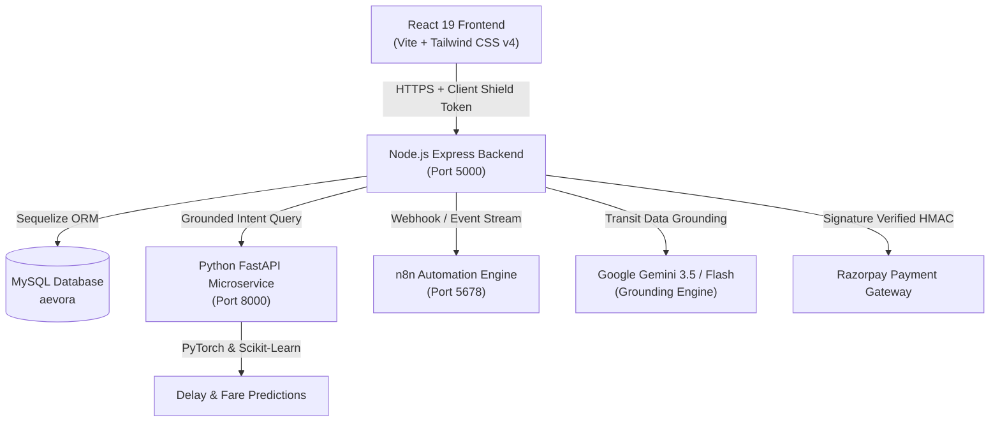

# 🌍 AEVORA — Intelligent Multi-Modal Travel & Mobility Platform

> **A smarter way to discover the world.**  
> *Discover. Connect. Explore.*

[](https://nodejs.org/)
[](https://www.python.org/)
[](https://react.dev/)
[](https://tailwindcss.com/)
[]()
[]()
[-blueviolet.svg)]()

---

## 📑 Table of Contents

- [Brand Identity](#-brand-identity)
- [Architectural Overview](#-architectural-overview)
- [Core Platform Capabilities](#-core-platform-capabilities)
- [System Architecture](#-system-architecture)
- [Project Directory Structure](#-project-directory-structure)
- [Quick Start Guide](#-quick-start-guide)
  - [Prerequisites](#prerequisites)
  - [1. Backend Setup](#1-backend-setup)
  - [2. Frontend Setup](#2-frontend-setup)
  - [3. AI Services Setup](#3-ai-services-setup)
  - [4. n8n Automation Engine](#4-n8n-automation-engine)
- [Environment Configuration](#-environment-configuration)
- [Cybersecurity & Threat Mitigations](#-cybersecurity--threat-mitigations)
- [Testing & Quality Assurance](#-testing--quality-assurance)
- [B2B API Platform & Developer Hub](#-b2b-api-platform--developer-hub)
- [Visual Identity & Design Tokens](#-visual-identity--design-tokens)
- [Future Development Roadmap](#-future-development-roadmap)
- [License](#-license)

---

## 💎 Brand Identity

| Element | Specification |
| :--- | :--- |
| **Brand Name** | **AEVORA** |
| **Tagline** | *A smarter way to discover the world.* |
| **Philosophy** | *Discover. Connect. Explore.* |
| **Positioning** | AI-powered unified travel intelligence and mobility platform |
| **Personality** | Futuristic • Intelligent • Professional • Minimal • Reliable • Global |
| **Primary Palette** | Midnight Navy (`#101B2D`), Electric Cyan (`#20C5D9`), Aurora Teal (`#42D6B5`) |
| **Typography** | Headings: **Sora** • Body: **Inter** |

---

## 🏛️ Architectural Overview

AEVORA is engineered as a resilient, high-performance distributed microservices platform:



---

## ✨ Core Platform Capabilities

### 🚆 Multi-Modal Transit Engine & Zero-Generative Routing
- **Deterministic Transit Scheduling:** 8,500+ verified Indian railway stations loaded idempotently with authoritative schedules, train frequencies, running days, and validated fares. Zero hallucinated routes.
- **Universal Hub Architecture:** 2-leg and 3-leg connecting chain discovery across national mega-junctions (NDLS, DDU, BSB, CNB, PNBE, HWH, CSMT).
- **Multi-Station City Clusters:** Co-located metro terminals (e.g. Delhi NCR: NDLS, DLI, ANVT, NZM) with automatic inter-terminal transfer coordination.
- **Strict Station Resolution:** Deterministic station mapping with approved alias tables (e.g. Jatni ➔ Khurda Road `KUR`, Berhampur ➔ Brahmapur `BAM`). Unknown stations return structured `STATION_NOT_FOUND` errors.
- **Multi-Modal Alternatives:** Flights via nearest airports and verified intercity AC buses for seamless first-to-last-mile connectivity.

### 🤖 Grounded AI Chatbot & Voice Concierge
- **Multi-Tier Grounded Routing:** Queries deterministic local database first; constructs `<verified_transit_data>` XML grounding; answers strictly with verified transit facts.
- **Web Search & Knowledge Grounding:** Integrated with Google Gemini for natural travel advice backed by verified timetable facts.
- **AEVORA Voice Concierge:** Browser Web Speech integration for hands-free voice search and journey requests.

### 💳 Bulletproof Payment & Booking Lifecycle
- **Tamper-Proof Checkout:** Authoritative server-side booking fare binding (prevents client-side amount tampering).
- **Durable Webhook Reconciliation:** Captures valid gateway payments even after booking hold expiry, transitioning into `refund_requested` / `reconciliation_required` without dropping events.
- **Atomic Concurrency Protection:** Row-level locks enforcing an exact pending-booking cap (5 pending bookings per user max) across concurrent requests.
- **Database-Enforced Idempotency:** Composite unique constraints `(user_id, operation, idempotency_key)` preventing duplicate bookings during retries or network replays.
- **Official E-Tickets & Tax Invoices:** Printable PDF receipts with QR codes, PNR telemetry, and GST-compliant invoices.

---

## 📁 Project Directory Structure

```text
├── ai-services/              # Python FastAPI Machine Learning Microservice
│   ├── ai_engine/            # PyTorch Deep Learning Models (LSTM delay, smart fare, crowd)
│   ├── tests/                # Automated AI Route & Authentication Test Suites
│   ├── main.py               # FastAPI App & Endpoints
│   └── requirements.txt      # Python Dependencies
├── backend/                  # Node.js Express Core Backend
│   ├── config/               # Database, Security, & Environment Configurations
│   ├── controllers/          # Business Logic (Auth, Travel, Bookings, Payments, Admin)
│   ├── data/                 # Authoritative Stations & Timetable Datasets (8,538+ records)
│   ├── middleware/           # Rate Limiters, Client Shield, RBAC, Auth Guards
│   ├── models/               # Sequelize ORM Schemas (User, Booking, Station, Train)
│   ├── routes/               # API Endpoints (/api/auth, /api/travel, /api/payment, etc.)
│   ├── seeders/              # Idempotent Station & Chatbot Seeding Scripts
│   ├── services/             # Deterministic Routing, Razorpay, Email, n8n Services
│   └── tests/                # 27 Comprehensive Automated Regression Test Suites
├── frontend/                 # React 19 Client Application (Vite + Tailwind CSS v4)
│   ├── public/
│   │   ├── brand/            # Official AEVORA Vector Assets (SVG Logos & Monograms)
│   │   └── favicon.svg       # AEVORA Monogram Favicon
│   └── src/
│       ├── components/       # UI Components, Modals, Navbar, Sidebar
│       │   └── brand/        # Reusable <Logo /> Component
│       ├── config/           # branding.js Centralized Brand Tokens
│       ├── context/          # AuthContext, ThemeContext
│       ├── pages/            # LandingPage, Dashboard, LiveTracking, Destinations, Admin
│       └── styles/           # brand.css & index.css Design System
├── docs/                     # Technical Architecture & Reverse Engineering Docs
└── README.md                 # Project Documentation
```

---

## 🚀 Quick Start Guide

### Prerequisites
- **Node.js:** v20.x or higher
- **Python:** v3.11 or v3.12
- **MySQL:** v8.0 or higher
- **npm:** v10.x or higher

### 1. Backend Setup
```bash
cd backend
npm install
cp .env.example .env
# Edit .env with your MySQL credentials, JWT_SECRET, and RAZORPAY keys
node seeders/stationSeeder.js
npm run dev
# Backend runs on http://localhost:5000
```

### 2. Frontend Setup
```bash
cd frontend
npm install
npm run dev
# Frontend runs on http://localhost:5173
```

### 3. AI Services Setup
```bash
cd ai-services
python -m venv .venv
# Windows: .venv\Scripts\activate | Unix: source .venv/bin/activate
pip install -r requirements.txt
python -m uvicorn main:app --host 0.0.0.0 --port 8000 --reload
# AI Service runs on http://localhost:8000
```

---

## 🎨 Visual Identity & Design Tokens

AEVORA features a unified color system configured across CSS variables and React tokens:

| Token | Hex | Role | Usage |
| :--- | :--- | :--- | :--- |
| `Midnight Navy` | `#101B2D` | Primary Brand | Headers, Hero background, Dark surfaces |
| `Electric Cyan` | `#20C5D9` | Primary Accent | Active states, CTAs, Vector path nodes |
| `Aurora Teal` | `#42D6B5` | Secondary Accent | Gradients, Badges, Success indicators |
| `Cloud White` | `#F4F7FB` | Background | Light mode body background |
| `Pure White` | `#FFFFFF` | Surface | Cards, Modals, Panels |
| `Slate Grey` | `#64748B` | Secondary Text | Labels, Subheadings, Captions |

### Typography
- **Heading Font:** `Sora`, -apple-system, BlinkMacSystemFont, sans-serif
- **Body Font:** `Inter`, -apple-system, BlinkMacSystemFont, sans-serif

---

## 🔒 Cybersecurity & Threat Mitigations

AEVORA implements enterprise-grade security controls verified by automated test suites:
- **Zero Generative Routing (ZGR):** Strict deterministic routing prevents LLM hallucination of routes, station codes, or ticket prices.
- **Client Shield Token:** Cryptographic entropy header required on outgoing API requests to mitigate automated scrapers.
- **Reverse Proxy Protection:** Proxy-aware rate limiting with strict hop validation and IPv4/IPv6 address normalization.
- **Multi-Device Session Hardening:** Strict device bounds (max 2 desktop, 2 mobile active sessions) with automatic revocation of oldest sessions.
- **Decoupled Gateway Operations:** External network calls to Razorpay occur outside active database transactions to prevent connection exhaustion.

---

## 🧪 Testing & Quality Assurance

Run the comprehensive automated test suite across all subsystems:

```bash
# Run all backend regression suites (27/27 suites)
cd backend
node tests/runAllTests.js

# Build frontend production bundle
cd ../frontend
npm run build
```

---

## 🗺️ Future Development Roadmap

- [ ] **Cross-Border Asian Rail:** Extend deterministic multi-modal corridor graph to neighboring SAARC rail corridors.
- [ ] **Direct Airline GDS Integration:** Direct NDC carrier ticket reservation integration.
- [ ] **Intercity Bus Operator API:** Live seat selection and boarding pass generation with state road transport corporations.
- [ ] **Offline PWA Ticket Wallet:** Cryptographically signed offline ticket verification with QR scanner support.

---

## 📄 License

AEVORA Travel Technologies Inc. Distributed under the MIT License.
