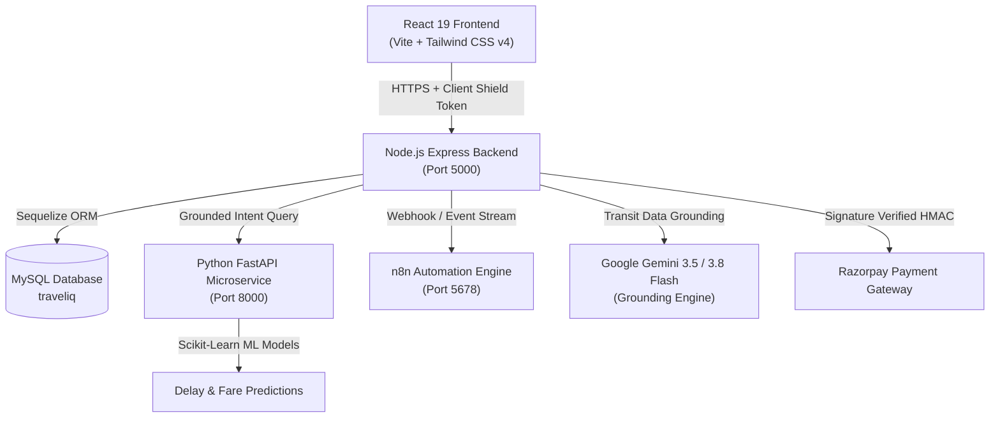

# 🌍 TravelIQ — Intelligent Multi-Modal Travel & Transit Platform

> Production-ready, AI-powered travel optimization platform for Indian transit. Combines deterministic rail scheduling, multi-modal connecting routes (trains, flights, intercity buses), zero-generative grounding, Razorpay payments, enterprise cybersecurity hardening, and autonomous n8n workflows.

[](https://nodejs.org/)
[](https://www.python.org/)
[](https://react.dev/)
[](https://tailwindcss.com/)
[]()
[]()
[-blueviolet.svg)]()

---

## 📑 Table of Contents

- [Architectural Overview](#-architectural-overview)
- [Key Features](#-key-features)
- [System Architecture](#-system-architecture)
- [Project Directory Structure](#-project-directory-structure)
- [Quick Start Guide](#-quick-start-guide)
  - [Prerequisites](#prerequisites)
  - [1. Backend Setup](#1-backend-setup)
  - [2. Frontend Setup](#2-frontend-setup)
  - [3. AI Services Setup](#3-ai-services-setup)
  - [4. n8n Automation Engine](#4-n8n-automation-engine)
- [Environment Variables](#-environment-variables)
- [Cybersecurity & Threat Mitigations](#-cybersecurity--threat-mitigations)
- [Testing & Quality Assurance](#-testing--quality-assurance)
- [API Documentation & Developer Platform](#-api-documentation--developer-platform)
- [License](#-license)

---

## 🏛️ Architectural Overview

TravelIQ is engineered as a resilient, high-performance distributed microservices platform:



---

## ✨ Key Features

### 🚆 Multi-Modal Transit Engine & Zero-Generative Routing
- **Deterministic IRCTC Rail Schedules:** Guaranteed non-hallucinatory schedules, train frequencies, running days, and authoritative fares.
- **Universal Hub Architecture:** 2-leg and 3-leg connecting chain discovery across national mega-junctions (NDLS, DDU, BSB, CNB, PNBE, HWH, CSMT).
- **Multi-Station City Clusters:** Co-located metro terminals (e.g. Delhi NCR: NDLS, DLI, ANVT, NZM) with automatic inter-terminal transfer coordination.
- **Intelligent Date Fallback:** Automatic defaulting to tomorrow's date with transparent notices when the traveler omits the date.
- **Multi-Modal Alternatives:** Flights via nearest airports and verified intercity AC buses (UPSRTC) for seamless last-mile connectivity.

### 🤖 Gemini Grounded Chatbot Concierge
- **Multi-Tier Grounded Routing:** Queries deterministic local database first; constructs `<verified_transit_data>` XML grounding; answers strictly with verified train schedules.
- **Web Search & Knowledge Grounding:** Integrated with Google Gemini 3.5/3.8 Flash Lite for natural travel advice backed by verified timetable facts.
- **Voice Concierge:** Browser Web Speech integration for hands-free voice search and itinerary requests.

### 💳 Bulletproof Payment & Booking Lifecycle
- **Tamper-Proof Checkout:** Authoritative server-side booking fare binding (prevents amount tampering).
- **Cryptographic Webhook Verification:** Raw-body HMAC-SHA256 signature verification preventing signature replays and fake status payloads.
- **Safe State Machine Transitions:** `Pending ➔ Success ➔ Refunded` atomic transitions with optimistic locking and rollback protections.
- **Co-branded Official E-Tickets:** Printable PDF and clean web receipts with QR codes and PNR telemetry.

### 🏨 Hotel & Hostel Accommodations
- **Nationwide Coverage:** 1,100+ verified stays (including hostels, dorms, and boutique hotels) across 51 major Indian cities.
- **Zero-Trust KYC:** Server-side government ID verification and IDOR-isolated reservations.

### 🛡️ Enterprise Cybersecurity Hardening
- **Client Shield Anti-Scraping:** Cryptographic client telemetry entropy tokens defending against automated scrapers without user friction.
- **WebAuthn / Passkeys & MFA:** FIDO2 passkey registration/login and TOTP two-factor authentication.
- **Session Reuse & Revocation:** Cryptographic token rotation with automatic multi-session termination upon replay detection.
- **Role Hierarchy (RBAC):** Super Admin, Data Manager, and Support Agent authorization boundaries.
- **OWASP Hardening:** SQL injection protection on dynamic queries, CSV formula injection neutralization, file upload MIME/extension whitelisting, and strict CSP headers.

---

## 📁 Project Directory Structure

```
TravelIQ/
├── frontend/               # React 19 + Vite + Tailwind CSS v4 Client SPA
│   ├── src/
│   │   ├── components/     # UI widgets, modals, Navbar, Footer, Passenger selector
│   │   ├── pages/          # Landing, Search, Live Tracking, Profile, Admin Dashboard
│   │   ├── context/        # Auth, Theme, Travel State Providers
│   │   └── utils/          # API client, Client Shield token generator, helpers
│   └── README.md
├── backend/                # Node.js + Express + Sequelize MySQL Server
│   ├── config/             # Database connection, security settings
│   ├── controllers/        # Auth, Payments, Bookings, Chatbot, Admin, Developer APIs
│   ├── middleware/         # Auth, Role, Anti-Scraping Shield, Rate Limiters, Uploads
│   ├── models/             # Sequelize data models (User, Booking, Train, Station, etc.)
│   ├── routes/             # REST endpoints (auth, travel, payment, admin, etc.)
│   ├── seeders/            # Initial datasets for stations, trains, foods, stays
│   ├── services/           # Deterministic routing, MultiModal engine, n8n, email
│   ├── tests/              # 22 Comprehensive automated test suites (100% Passing)
│   └── README.md
├── ai-services/            # Python FastAPI Microservice
│   ├── models/             # Trained scikit-learn models (delay, fare, crowd)
│   ├── tests/              # Pytest security and prediction tests
│   ├── main.py             # FastAPI entry point & API endpoints
│   ├── rag_engine.py       # RAG Vector similarity & Knowledge retrieval
│   └── README.md
├── n8n/                    # Autonomous Workflow Automations
│   ├── workflows/          # JSON workflows (Support AI, Booking Briefing, Delay Alert)
│   ├── docker-compose.yml  # n8n container deployment
│   └── README.md
└── docker-compose.yml      # Full-stack container orchestration
```

---

## 🚀 Quick Start Guide

### Prerequisites
- **Node.js**: v20.x or higher
- **Python**: v3.11, v3.12, or v3.14
- **MySQL Server**: v8.0+ running locally or in Docker
- **Git**

---

### 1. Backend Setup

```bash
cd backend
npm install

# Configure environment
cp .env.example .env   # Or create .env with DB credentials (see Environment Variables)

# Run seeders & start server
npm run dev
```

Backend will start on: **`http://localhost:5000`**  
Health check endpoint: **`http://localhost:5000/api/health`**

---

### 2. Frontend Setup

```bash
cd frontend
npm install
npm run dev
```

Frontend will open at: **`http://localhost:5173`**

---

### 3. AI Services Setup

```bash
cd ai-services
python -m venv venv

# Windows PowerShell:
.\venv\Scripts\Activate.ps1
# macOS / Linux:
source venv/bin/activate

pip install -r requirements.txt
python main.py
```

AI Microservice will start on: **`http://localhost:8000`**  
API Documentation (Swagger): **`http://localhost:8000/docs`**

---

### 4. n8n Automation Engine (Optional)

```bash
# Option A: Run via NPX
npx n8n

# Option B: Run via Docker
cd n8n
docker compose up -d
```

Access the n8n UI at: **`http://localhost:5678`**

---

## 🔐 Environment Variables

Key backend variables (`backend/.env`):

| Variable | Description | Default / Example |
|---|---|---|
| `PORT` | Backend listening port | `5000` |
| `DB_HOST` | MySQL hostname | `localhost` |
| `DB_PORT` | MySQL port | `3306` |
| `DB_NAME` | Database name | `traveliq` |
| `DB_USER` | MySQL database user | `root` or `traveliq_app` |
| `DB_PASSWORD` | MySQL user password | `••••••••` |
| `JWT_SECRET` | Primary JWT signing secret (min 32 chars) | Generated random key |
| `JWT_REFRESH_SECRET` | Refresh token signing secret | Generated random key |
| `GEMINI_API_KEY` | Google Gemini Studio API Key | `AIzaSy...` or `AQ....` |
| `CLIENT_SHIELD_SECRET` | Secret for cryptographic anti-scraping tokens | Generated hex string |
| `RAZORPAY_KEY_ID` | Razorpay public key identifier | `rzp_test_...` |
| `RAZORPAY_KEY_SECRET` | Razorpay webhook & verification secret | Generated secret |
| `N8N_WEBHOOK_SECRET` | HMAC token for authenticating n8n callbacks | `traveliq_n8n_secret_...` |

---

## 🛡️ Cybersecurity & Threat Mitigations

TravelIQ has undergone comprehensive cybersecurity hardening covering:

1. **Anti-Scraping Client Shield:** Validates high-entropy browser telemetry tokens, preventing headless bot scraping.
2. **Replay & Mismatch Payment Prevention:** Enforces raw-body HMAC-SHA256 signature verification and authoritative fare checks.
3. **Session Revocation & Reuse Detection:** Rotates refresh tokens and terminates all sessions instantly upon detecting reuse of a revoked token.
4. **CSV Formula Injection (CWE-1236):** Sanitizes exported cells starting with `=, +, -, @` with prepended `'`.
5. **Dynamic ORDER BY Whitelisting (CWE-89):** Restricts sort fields strictly to permissible model attributes.
6. **Safe File Uploads:** Validates both MIME types and file extensions (`.jpg`, `.png`, `.webp`) and guards against path traversal in file deletion.
7. **JWT Algorithm Pinning (CWE-327):** Strictly pins `{ algorithms: ['HS256'] }` on all token verification paths.

---

## 🧪 Testing & Quality Assurance

### Run Backend Test Suites (22 Suites)
```bash
cd backend
npm test
```
*Coverage includes:* Auth isolation, Payment verification, Booking regression, Payment integrity, Shield regression, Session revocation, Checkout contract, Role hierarchy, MFA passkeys, Private attachments, Mass assignment, Hotel reservation integrity, n8n prompt injection, Cybersecurity hardening, Transit routing, Anti-hallucination, and E2E integration.

### Run AI Services Pytest Suite (8 Suites)
```bash
cd ai-services
python -m pytest tests/test_security_and_metrics.py
```

---

## 📄 License

This project is licensed under the **ISC License**. Developed with ❤️ for smart, safe Indian transit.
