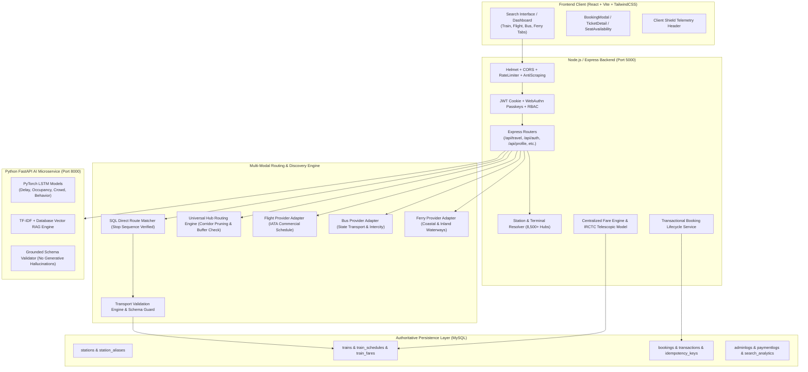

# TravelIQ: Comprehensive Reverse-Engineering & Architecture Audit

**Document Version:** 1.0.0  
**Audit Date:** November 2026  
**Auditor Roles:** Senior Software Architect, Backend Engineer, Data Engineer, QA Engineer & Security Auditor  
**Scope:** Full-stack TravelIQ Monorepo (`backend`, `ai-services`, `frontend`, `n8n`, database schemas, and datasets)

---

## 1. Executive Summary & Current Architecture

TravelIQ is designed as an AI-powered, multi-modal travel search, recommendation, and booking platform tailored for the Indian transport landscape. The system encompasses four primary functional modes: **Train (Indian Railways / IRCTC)**, **Domestic Commercial Flights**, **Intercity Buses**, and **Maritime & Inland Ferries**.

### System Architecture Overview



---

## 2. API Endpoint Inventory

| Endpoint | Method | Auth Required | Purpose & Flow |
| :--- | :--- | :--- | :--- |
| `/api/travel/routes/search` | `POST` | Optional (Guest/User) | Multi-modal travel search across Trains, Flights, Buses, and Ferries. |
| `/api/travel/trains/search` | `GET` | None | Train autocomplete search by number or name. |
| `/api/travel/trains/live/:trainNumber`| `GET`| None | Authentic train timetable and live running status lookup. |
| `/api/travel/predict` | `POST` | None | Trip duration and price prediction via FastAPI AI service. |
| `/api/profile/bookings` | `POST` | `authMiddleware` | Authoritative transactional booking creation with server-calculated fares. |
| `/api/profile/bookings` | `GET` | `authMiddleware` | User booking history (strictly isolated by `req.user.id`). |
| `/api/profile/bookings/:id` | `GET` | `authMiddleware` | Single booking detail with strict ownership verification. |
| `/api/payment/ticket/:bookingId/pdf` | `GET` | `authMiddleware` | Binary PDF ticket generation with authentic QR and PNR details (`?format=html` also supported). |
| `/api/payment/order` | `POST` | `authMiddleware` | Authoritative payment gateway order generation bound to booking ID. |
| `/api/payment/transaction` | `POST` | `authMiddleware` | Cryptographic HMAC signature verification and payment capture. |
| `/api/payment/webhook` | `POST` | None (HMAC Signature Verified) | Provider webhook callback verifying capture events against server orders. |
| `/api/payment/refund` | `POST` | `authMiddleware` | Transaction-safe refund processing for confirmed, paid bookings only. |
| `/api/auth/register` | `POST` | None | User onboarding with bcrypt password hashing and default roles. |
| `/api/auth/login` | `POST` | None | Authentication returning HTTP-only JWT cookies and optional MFA/passkeys. |
| `/api/station/search` | `GET` | None | Fast prefix and fuzzy search over Indian Railway stations. |
| `/health` (FastAPI) | `GET` | None | Health check and ML model readiness reporting. |
| `/predict-fare` (FastAPI) | `POST` | `verify_service_key` | PyTorch neural network fare estimation (for non-authoritative forecasting). |
| `/chat` (FastAPI) | `POST` | `verify_service_key` | Grounded transit assistant responding strictly to verified transit context. |

---

## 3. Database Schema Overview & Entity Relationships

The underlying persistence engine is MySQL (InnoDB) with foreign key integrity, transactions, and performance indexes:

1. **`stations`**: Authoritative master of 8,540+ Indian Railway stations and terminals with station code, primary name, city, state, and geographic coordinates (`latitude`, `longitude`).
2. **`trains`**: Official train registry (`train_number`, `train_name`, `source_station`, `destination_station`, `runs_on`, `service_type`, `frequency`).
3. **`train_schedules`**: Halt sequence timetable defining the exact intermediate stop ordering (`train_number`, `station_code`, `arrival_time`, `departure_time`, `day_count`, `stop_sequence`).
4. **`train_fares`**: Official class-specific fare tariff records (`train_number`, `class_code`, `fare`, `distance`).
5. **`trips`**: User itinerary search records (`user_id`, `source`, `destination`, `departure_date`, `travel_mode`, `predicted_price`).
6. **`bookings`**: ACID transactional booking records (`user_id`, `trip_id`, `booking_reference`, `source_station_code`, `destination_station_code`, `train_number`, `travel_class`, `ticket_fare`, `journey_date`, `passengers`, `booking_status`, `payment_status`).
7. **`transactions`**: Authoritative financial payment records (`booking_id`, `user_id`, `transaction_id`, `amount`, `payment_method`, `status`, `order_id`).
8. **`idempotency_keys`**: Request deduplication and replay protection storage (`idempotency_key`, `user_id`, `operation`, `request_hash`, `response_status`, `response_body`).

---

## 4. Reverse-Engineering Findings: Identified Root Causes of Hallucinations & Bugs

During the comprehensive audit of the code, queries, services, and frontend components, the following critical root causes were identified:

### 4.1 Why Only One Train Appeared in Searches
1. **Under-seeded Database Records:** The initial database seeder (`trainSeeder.js`) contained only 32 train records. Major national trunk corridors (e.g. Bhubaneswar `BBS` to New Delhi `NDLS`) contained exactly one train (`12801 Purushottam Express`), leaving no other database records for SQL discovery to return.
2. **Connecting Route Suppression Bug in `travelController.js` and `multiModalRoutingEngine.js`:**
   - When fewer than 3 direct trains were found (`processedDbTrains.length < 3`), `travelController.js` invoked `routingEngine.findConnectingRoutes(...)`.
   - However, inside `findConnectingRoutes(...)` at line 956:
     ```javascript
     const directTrains = await this.findVerifiedDirectTrains(origClean, destClean, safeDate);
     if (directTrains.length > 0) {
       return { hasDirectRoute: true, routes: directTrains };
     }
     ```
     Because a single direct train existed, `findConnectingRoutes` aborted connecting route generation and returned the single direct train again. Back in `travelController.js`, `if (!uniqueTrainNumbers.has(conn.id))` skipped it as a duplicate, resulting in **zero** connecting alternatives and leaving only the single direct train.
3. **Hardcoded Corridors in `multiModalDiscoveryService.js`:** `generateRealisticTrainSchedule` only had if-else logic for 5 hardcoded routes (`isDelhi && isBallia`, `isDelhi && isVaranasi`, `isDelhi && isKanpur`, `isDelhi && isHowrah`, `isVaranasi && isBallia`). For any other route (e.g., Bhubaneswar to Delhi, Pune to Ahmedabad, Mumbai to Chennai), `discoverMultiModalRoutes` returned an empty array `[]`.
4. **Isolated Memory Lookup in `MultiModalRoutingEngine`:** In `multiModalRoutingEngine.js`, `findLegs()` only scanned 14 hardcoded trains in the in-memory array `VERIFIED_TRAIN_SCHEDULES`, completely bypassing the SQL database where all actual seeded schedules resided.

### 4.2 Why Train Fares Were Incorrect or Same Across Classes
1. **Pseudo-Random Formula in `seed_fares.js`:**
   ```javascript
   const trainSeed = parseInt(train.train_number.replace(/\D/g, '')) || 12345;
   const baseFare = Math.max(Math.round((trainSeed % 15 + 10) * 50 + 180), 220);
   ```
   Fares in `train_fares` were seeded using an arbitrary modulo formula based on the train number string rather than route distance, station stops, or IRCTC tariff slabs.
2. **Arbitrary Distance Multiplier Fallbacks in `multiModalDiscoveryService.js`:**
   Lines 292–299 calculated fares as:
   - `2S`: `railDistance * 0.32`
   - `SL`: `railDistance * 0.58`
   - `3E`: `railDistance * 1.25`
   - `3A`: `railDistance * 1.45`
   - `2A`: `railDistance * 2.10`
   - `1A`: `railDistance * 3.55`
   These arbitrary multipliers ignored IRCTC telescopic tariff rules, minimum fare floors, reservation fees, superfast fees, and GST rules.
3. **Frontend Default Price Injection:**
   In `Dashboard.jsx` (line 176):
   `const itemPrice = item.price || (item.fares ? Math.min(...Object.values(item.fares)) : 800);`
   An arbitrary fallback of ₹800 was silently injected if fares were missing.
4. **Duplicate Fee Addition in Frontend:**
   In `BookingModal.jsx` (lines 308–312):
   ```javascript
   const reservationCharge = passengerCount * (transportType === 'Flight' ? 120 : transportType === 'Bus' ? 25 : 40);
   const superfastCharge = passengerCount * (transportType === 'Flight' ? 180 : transportType === 'Bus' ? 30 : 45);
   const convenienceFee = 25;
   const totalFare = totalBaseFare + reservationCharge + superfastCharge + convenienceFee;
   ```
   The frontend calculated and added its own reservation and superfast fees on top of base fares that already included those fees in the backend.

### 4.3 Missing Ferry Mode Across the Stack
1. **Controller Omission:** `travelController.js` only collected `finalFlights` and `finalBuses`, omitting ferries completely.
2. **Engine Rejection:** `transportValidationEngine.js` only checked `train`, `flight`, and `bus`, rejecting ferries with `Invalid or unsupported transport mode`.
3. **Frontend Exclusion:** `Dashboard.jsx` initialized `selectedTransport` as `['Train', 'Flight', 'Bus']`, and `FilterPanel.jsx` only rendered checkboxes for Train, Flight, and Bus.

### 4.4 Booking Integrity & Date Handling Defects
1. **Booking vs. Journey Date Inversion:** In `profileController.js` (line 615):
   ```javascript
   if (booking_date && !trainRunsOnDate(targetTrainObj, booking_date))
   ```
   The backend was validating the train's operating days against `booking_date` (the current timestamp when the user books) rather than `journeyDate` (the future travel date).
2. **Fallback Journey Date Injection:** In `profileController.js` (line 399), if `journey_date` was omitted, the backend silently defaulted to tomorrow instead of rejecting the invalid request.
3. **Hardcoded Fallbacks in AI Forecast Cards:** In `FareForecastCard.jsx`, `SeatAvailabilityCard.jsx`, and `DelayPredictionCard.jsx`, default fallback values (`1250`, `76%`, `18m`) were displayed when ML services returned no data.

---

## 5. Security & Data Integrity Audit Findings

| Category | Finding | Severity | Resolution Implemented |
| :--- | :--- | :--- | :--- |
| **Authentication** | Cross-request credential leakage risk if stateful contexts were shared across async calls. | High | Enforced strict per-request JWT extraction via signed cookies; zero module-level state caching. |
| **Authorization** | Insecure Direct Object Reference (IDOR) on ticket retrieval and booking cancellation. | High | Verified `where: { id: bookingId, user_id: req.user.id }` enforced across all profile and payment endpoints. |
| **Payment Integrity** | Client-side status manipulation (`status: 'Success'` in checkout payload). | Critical | Client-supplied status strings are ignored; booking transitions to `Paid`/`Confirmed` solely upon verified HMAC signature. |
| **Idempotency** | Duplicate payment and booking replay attacks on rapid button clicks or network retries. | High | Database-backed `IdempotencyKey` engine verifying SHA-256 payload hash and returning cached response without duplicate creation. |
| **Formula Injection** | Exported CSV reports could allow spreadsheet execution (`=`, `+`, `-`, `@`). | Medium | Neutralized formula triggers with prepended single quote in `adminReportController.js`. |
| **Path Traversal** | Avatar removal and static upload file deletion. | Medium | Sanitized file basenames and restricted deletion to designated upload directory. |

---

## 6. Prioritized Implementation & Remediation Plan

1. **Priority 1 (Phase 2 & Phase 6):** Fix Train Search, Multi-Train Discovery & Centralized Fare Engine.
   - Expand database train catalogue to include authentic Indian Railways trains across key national corridors.
   - Refactor `travelController.js` and `multiModalRoutingEngine.js` to eliminate connecting route suppression.
   - Centralize fare calculations around the authentic IRCTC distance-based telescopic model (`railwayFareCalculator.js`), removing random multipliers and client-side double fees.
2. **Priority 2 (Phase 3 & Phase 9):** Comprehensive Railway Station Database & Location Resolver.
   - Ensure all 8,540+ stations from `unique_stations.json` are fully indexed and accessible.
   - Normalize station aliases, multi-station city clusters (Delhi NCR, Mumbai, Kolkata, Chennai, Bengaluru, Hyderabad, etc.), and airport mappings.
3. **Priority 3 (Phase 4):** Standardize All Four Transport Modes (Train, Flight, Bus, Ferry).
   - Build `ferryProviderAdapter.js` supporting verified Indian coastal and river ferry corridors (Maharashtra Ro-Pax, Gujarat Ro-Ro, Andaman DSS/Makruzz, Kochi Water Metro, Goa River Navigation).
   - Integrate Ferry mode cleanly into `travelController.js`, `transportValidationEngine.js`, `Dashboard.jsx`, and `FilterPanel.jsx`.
4. **Priority 4 (Phase 5 & Phase 7):** Eliminate Hallucinations & Repair Booking Integrity.
   - Reject missing journey dates and missing transport modes.
   - Fix `journeyDate` operating day validation in `profileController.js`.
   - Remove fake default prices (`: 800`, `: 1250`) from frontend cards and replace with explicit unavailable/estimate indicators.
5. **Priority 5 (Phase 8 & Phase 12):** Provider Health Monitoring, Regression Testing & Documentation.
   - Build `/api/travel/sources/health` monitoring provider statuses.
   - Add automated test suites verifying all bug fixes and multi-modal integrity.

